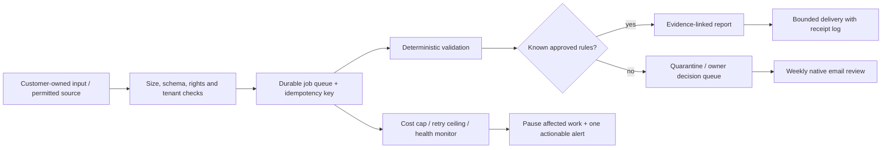

# Phone supervision and unattended operation

These are **proposed operating rules**, not a deployed system. Only the local prototype and financial tests described in the technical audit were executed. No phone, account, payment, live import, email delivery or production scheduler was tested. This distinction is a hard launch gate.

The assumed workday absence is up to ten hours; it is not a confirmed schedule. Choose one weekly review window and at most two short intervening checks. The owner supplies actual quiet hours before launch; a provisional 08:00–18:00 local quiet period is a planning example, not a timezone/country inference. A 2-minute check on five days plus a 35-minute batch is already 45 minutes, before support. Here we instead budget two 3-minute checks plus one 24-minute review, with the remaining scheduled minutes reserved for acquisition/maintenance/admin. No daily engagement obligation.

## What the phone can actually do

| Action | Existing interface / evidence | Proposed sequence | Estimated owner time | Status |
|---|---|---|---:|---|
| Read digest and attached preview | Owner's native email app | Open labelled thread; read figures; open sanitized report; zoom/scroll | 2–4 min, 3–6 taps | Native capability expected; chosen app/file preview must be tested |
| Approve an already prepared manual report | Native email | Review recipient, version/hash and attachment; send prepared reply/report | 2 min, 4–7 taps | Proposed manual workflow, not an approval API |
| Ask for revision / reject | Native email | Reply with issue ID and one of the prewritten instructions; no re-sending raw secrets | 1–3 min | Manual during pilot; automation must not infer approval from vague replies |
| Refund eligible service payment | Stripe Dashboard if available to owner | Payments → successful payment → Refund → amount/review | 1–2 min, ~5 taps | Official iOS/Android refund capability documented; owner account/phone untested |
| Stop new checkout | Stripe iOS Payment Links or processor's web dashboard | Select link; deactivate; confirm public checkout is disabled | 1–3 min | Stripe documents iOS action; Android equivalent is not assumed |
| Gumroad product refund | Gumroad web Sales dashboard | Open sale; inspect; full/partial refund if balance permits | 2–4 min | Official web capability; mobile usability untested; do not promise native-app control |
| Lemon Squeezy refund for eligible software/download | Web Orders menu | Select order, full/partial refund; reconcile | 2–4 min | Official web capability; mobile usability untested; manual services excluded |
| Pause/retry a pipeline | Purchased scheduler's web console, if demonstrably usable | Pause workflow or retry ONLY idempotent job; inspect state | 2–5 min | Needs product selection and mobile test; not implemented |

Stripe documents refund management on both mobile platforms, while some payment-link/subscription controls are iOS-only; it also says its app only displays live data. Therefore no test-mode mobile refund is claimed: use a permitted web sandbox plus an owner-approved small real transaction later, or downgrade the mobile gate. [Stripe mobile documentation](https://docs.stripe.com/dashboard/mobile). Gumroad refunds require sufficient balance and the Gumroad dashboard. [Gumroad refund documentation](https://gumroad.com/help/article/47-how-to-refund-a-customer). Lemon Squeezy documents web refunds but excludes services from allowed products. [Refund order](https://docs.lemonsqueezy.com/help/orders/refund-order), [product restrictions](https://docs.lemonsqueezy.com/help/getting-started/prohibited-products).

The selected F3 pilot uses native email, a tested download storefront and native Pinterest scheduling. Product creation and formula repairs require laptop work; routine delivery should not. The alternative F1 service pilot would need a laptop batch to run local checks and prepare reports, counted as pilot work. Mature F1 needs persistent processing and a tested pause/retry interface; this is a missing component. Do not build a decorative custom dashboard. If an existing console cannot resolve the important actions on the owner's phone, retain a laptop exception path and downgrade the model until that burden is acceptable. A custom control screen is justified only if repeated paid use exposes that specific gap; allow 8–16 additional setup hours and re-test security, not a presumed free feature.

For the 45-minute F1/F4 scheduled budget, the 24-minute batch includes quality review (10), accounting/refund reconciliation (6), maintenance/backup/queue checks (5), and decisions (3); the two 3-minute checks add six, and acquisition management receives 15. More work in any category increases the total. This is a tight hypothetical budget, not observed productivity. At F1 base, the conversation-based acquisition scenario adds about 2 minutes/week; at 35 accounts it adds about 9; at optimistic 75 accounts it adds about 21. Thus channel-adjusted F1 weeks are about 64, 78 and 103 minutes respectively, even if other assumptions hold.

A bank reserve alone does not guarantee a Gumroad refund: sufficient accessible Gumroad balance is required. Retain an appropriate processor balance where supported, and verify how an insufficient balance is remedied before accepting sales. If that cannot be demonstrated, this payment route fails the pilot gate. No universal top-up capability is assumed.

## Rules by finalist

| Finalist | Previously approved routines | Batch decisions / mobile action | If ignored | Immediate alert / automatic protection |
|---|---|---|---|---|
| F1 supplier-specific preflight | Up to four files/account/month, same schema/version, max 5 MB/file, deterministic checks; after graduation send factual report with provenance | Preview weekly sample; reject false positive; ask client for corrected source; refund one $29 pilot/$39 cycle if warranted | New schema/rule change stays quarantined; existing valid routines continue. No generated correction imported anywhere | Unexpected data exposure, duplicate charge or hard spend cap triggers pipeline/checkout pause; no automatic store write exists |
| F2 weekly watchlist | Fetch allowlisted permitted sources at agreed cadence; cache and diff; compose source-linked draft | Review changed claims; approve weekly digest in native email; reject unsupported interpretation | Unapproved narrative never sends. Deliver pre-agreed status/staleness notice instead of fabricated current result; offer missed-cycle credit | Broad source failure stops new checks after retry ceiling; paid promise may be missed, reflected as refund/credit exposure |
| F3 template + Pinterest content | Existing tested template/download fulfillment; publish only already approved scheduled Pins within native limits | Preview scheduled image and destination; pause misleading Pin; reply to support; bounded refund | New drafts stay drafts; scheduled approved content/old product sales continue; weekly schedule eventually empties | Broken download or materially wrong formula pauses new sales; remove affected version and notify purchasers when authorized |
| F4 fixed monthly report | Receive customer-owned fixed export; deterministic reconciliations; create draft; optional contracted review | Preview totals and differences, approve file delivery, reject scope expansion; refund/credit if delayed | Draft stays unsent; automatic receipt states pending review, no invented completion. Account cap prevents uncontrolled backlog | Source integrity failure or accidental disclosure quarantines tenant; no advice or decisions automatically executed |

An action called “approve” is permission for that specific version, recipient and bounded commitment. Revisions invalidate earlier approvals. Silence never approves new recipients, expenses, publishing, rules, sources, contractors, subscriptions or data access. Previously approved routines may continue within their limits. A rejected file is not a successful service delivery; track it as failed/awaiting customer and honor the agreed remedy.

## Sample digest and queue

The example below is **synthetic** and combines a hypothetical F1 week with month-to-date finance. Actual bank data would be labelled ACTUAL; forecasts, reserves and missing data must stay labelled ESTIMATED/UNKNOWN.

```text
PiggleXO | weekly review | 12 Nov 2026 | SYNTHETIC EXAMPLE
NEXT ACTION: review job J104 schema change (2 min). No urgent workday action.

Customers: 5 active | Files this week: 5 | Complete: 4 | Held: 1
Queue: oldest held 18h | 0 duplicate deliveries | 1 failed parse
MTD booked sales: $195 ESTIMATED example; not bank cash
Fees: $22 EST | refund allowance: $5.85 EST | delivery: $6 EST
Contribution: $161.15 EST | acquisition: $8.75 EST | fixed: $65 EST
Operating profit: $87.40 EST before owner pay/tax (5-customer base-unit illustration)
Cash received: $0 example | processor receivable: $167.15 EST
Operating cash spent: $79.75 example | remaining bank reserve: UNKNOWN
Owner time: 18 min logged this week | 30 min approximate base-model budget remaining
Decisions: 1 schema question; 0 refunds; 0 new spend requests
Approved routines: continue | New schemas: held | paid checkout: bounded pilot only
```

| ID | Reason / age | Customer impact | Phone action | Deadline/default | Laptop need |
|---|---|---|---|---|---|
| J104 | New `net_price` field; 18h | Report pending; no live catalog change | Preview header summary; request mapping or reject | Next batch within 2 business days; hold, never guess | First mapping requires 15–30 min; reject scope if repeated |
| J105 | Retry exhausted | Old report available but labelled stale | Send prewritten delay/refund option | Before published delivery promise; refund/credit if not met | Log investigation if repeat |
| P003 | Customer requests refund | Cash obligation | Confirm order/amount; refund in processor | Published policy/applicable deadline; cannot invent one globally | Only if mobile cannot complete |

Deduplicate alerts on tenant + job fingerprint + failure class. One alert on transition to actionable failure, one escalation if a real deadline approaches, and one recovery notice; no repeated “still broken” notifications. Disable ordinary sale/customer push alerts during work. A weekly manual inbox/processor check is the fallback for push failure. Health monitors should notify on meaningful state change, not every scheduled run. For payment/security incidents, automation pauses the affected feature immediately so protection does not depend on answering a notification.

## Absence behavior and recovery

| Absence | F1 | F2 | F3 | F4 | Recovery and expected extra owner work |
|---|---|---|---|---|---|
| One missed check | Valid jobs continue; novel schema held | Draft awaits weekly batch | Existing downloads/scheduled Pins continue | Monthly draft stays held | Read one digest; 5–15 min if queue small |
| 10 workday hours | No live writes or urgent promise; queue can wait | Nonurgent source changes wait | New drafts wait; support response window disclosed | No same-day SLA | 3–10 min triage; avoid business requiring action during this window |
| 48 hours | Continue preapproved bounded jobs; failed job sends factual status after permitted retry; no new customers if backlog cap hit | If publication due, send only agreed status/credit option; analysis withheld | Delivery continues unless broken; content cadence may slow | Delivery can miss deadline; credit/refund exposure | 15–45 min; oldest deadlines first, maximum 5 held jobs processed per batch |
| Week of minimal supervision | Freeze onboarding/new rules; keep validated routines only; after 5 held jobs or oldest >48h stop accepting new processing | Suspend new watchlists; skip unreviewed issue and credit cycle; existing snapshots retained | Approved Pins exhaust; static tested product can keep selling; pause if support/refund backlog grows | Stop onboarding; late monthly report refunded/credited; contractor never silently substitutes owner approval | 45–120 min plus possible 1–3h laptop repair; admit temporarily lower revenue |

For all models, a planned absence requires checking upcoming deadlines, reducing checkout capacity and pre-notifying affected customers through an authorized workflow. An unexpected long absence cannot guarantee fulfillment: pause new paid orders when queue/age limits are exceeded. Existing subscription billing must also be suspended/credited for undeliverable cycles; merely stopping the worker is insufficient. A week pause can reduce monthly recurring revenue by roughly a quarter if an entire service week is lost; the outage scenario explicitly stresses 25% refunds. Static download access should remain available independently of the worker.

## Architecture to build only after demand gates



Persistent production service: managed small worker/database, not the owner's sleeping laptop. Schedule weekly plus upload-triggered jobs; store due time and tenant timezone. Queue states: received, validated, held, running, completed, delivery-pending, delivered, failed, canceled. Unique key = tenant + input hash + rule version + job intent. Use transactional state changes and delivery receipt identifiers. Retries at 5 min, 30 min, 2h for transient failures, maximum three; validation/permission failures never retry unchanged. No exactly-once guarantee is assumed across third-party delivery; reconcile provider receipt before retry and expose ambiguous delivery to review.

Keep raw files at most seven days in pilot, reports 30 days unless agreement requires otherwise; document deletion/export rights and permission to process files. Separate tenants, encrypted storage/transport, least-privilege service credentials, expiring download links, and no customer values in telemetry. No model sees raw commercial/customer data by default. Treat uploaded text as data, not instructions. AI may draft an explanation grounded in rule IDs; deterministic findings and citations remain authoritative. Disable AI if it invents a field/fix or cost exceeds allowance. A public URL checker needs SSRF protections and robots/terms checks; the supplied offline prototype never fetches URLs.

Daily encrypted backup of rules/queue/ledger; weekly automated restore check into isolated storage plus monthly owner spot-check, included in maintenance. Recovery targets are design assumptions: one-day maximum ledger loss before database backups are improved, service restoration within two business days. At most $5/day variable spend and model-specific monthly ceiling; per-tenant file limits; stop before issuing another paid API request when projected cap would be exceeded. Do not rely only on provider billing alerts. Audit token expirations weekly and alert 14/7/1 days ahead; reconnection never circumvents consent. Payment webhooks must be signed, replay-safe and reconciled weekly; never deliver twice on a repeated event.

Fallbacks: deterministic rules if AI unavailable; previous snapshot explicitly stale if source unavailable; native mail/manual report if automation fails; disable checkout if delivery is impaired; export consented customer/transaction data within platform rights; keep report generator portable. Google/social login, one payment provider, cloud host and domain/email are common dependencies across these models, so running several does not make them independent. No proposed fallback assumes exporting card credentials or transferring subscriptions automatically.

## Time by phase and retained human decisions

| Model | Setup laptop hours | Launch hours over first month | Typical mature week at base volume | Plausible bad week | Interruptions / response expectation | Laptop-only exceptions |
|---|---:|---:|---:|---:|---|---|
| F1 | 35–60 for hosted version; 4–8 for narrow pilot tooling | 12–25 acquisition plus 3–6 supervised delivery | 61 min, before any extra acquisition noted in model | 180–300 min | 0 urgent routine; 0–2 batched issues; 2-business-day support target | New schema, deploy/restore, account recovery |
| F2 | 10–20 | 8–16 | 79 min | 180–240 min | 1 weekly editorial decision; source outages batched | Selector repairs, rights review, source replacement |
| F3 | 8–16 product + 4–8 original creative work | 8–16 | 80 min | 150–240 min | 1 weekly content batch; 0–2 support issues | Formula fix, asset production, listing recovery |
| F4 | 12–24 | 8–16 | 67 min | 180–360 min | Monthly deadline; 0–2 batched clarification issues | New data mapping, reconciliations, contractor replacement |

All hours are estimates. A single outage can exceed the preferred weekly workload; recurring workday urgency disqualifies the offer. F1's retained schema decisions reduce false warnings but can become consulting: after two custom requests from one account, narrow the accepted format or stop that account. F2 editorial review prevents meaningless change spam. F3 one honest original example improves trust; it does not require daily face-led content. F4 signed-off totals improve reliability but monthly revisions can destroy margin. Measure each decision's saved rework and customer value; remove only decisions whose elimination passes a controlled quality/workload test.
